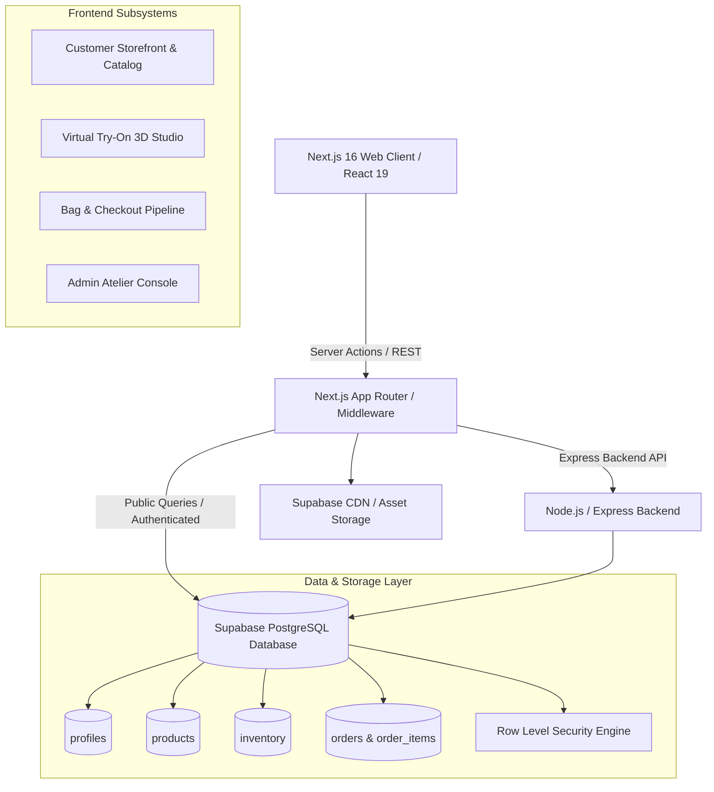
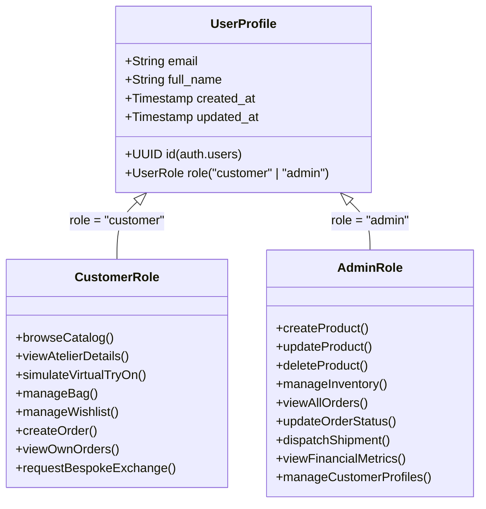
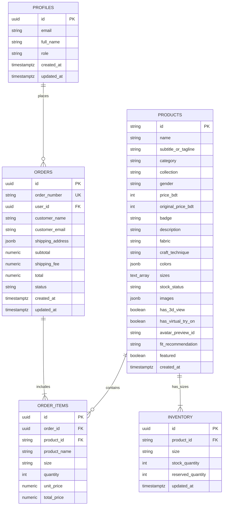

# OOTFY — Luxury Fashion E-Commerce Architecture & Project Plan

> **System Vision:** OOTFY is an atelier-grade luxury fashion e-commerce platform dedicated to celebrating contemporary Bangladeshi textile heritage (Dhakai Jamdani, Rajshahi Mulberry Silk, Comilla Khadi, Tangail Cotton) combined with cutting-edge digital craftsmanship, photographic realism, and real-time 3D Virtual Try-On experiences.

---

## 1. Executive Summary & Core Objectives

OOTFY bridges high-end artisanal handloom fashion with modern digital commerce. Unlike generic e-commerce templates, OOTFY delivers:
- **100% Garment-Centric Photography:** Clean, model-free atelier presentations (flatlays, sculptural drapes, fabric macros, folded packshots) avoiding human face distractions or clutter.
- **Interactive "See It On You" Virtual Try-On Studio:** High-fidelity 3D garment visualization featuring 4 dynamic camera perspectives (`VIDEO`, `FRONT`, `¾ VIEW`, `BACK`), body fit presets (`Slim`, `Regular`, `Relaxed`), height scaling, and colorway adaptation.
- **Role-Based Luxury Workflows:** Tailored, secure experiences separating sophisticated customer exploration from administrative atelier inventory, order fulfillment, and bespoke sizing adjustments.

---

## 2. System Architecture & Tech Stack

### Technology Matrix
| Layer | Technology | Key Capabilities & Rationale |
| :--- | :--- | :--- |
| **Frontend Framework** | **Next.js 16.4.6 (App Router)** | Hybrid SSG/SSR, Turbopack, static catalog generation (55+ pre-rendered pages), zero-latency client transitions. |
| **UI & Styling** | **Tailwind CSS 3.4 + CSS Variables** | Custom luxury color tokens (`#243329` Deep Forest, `#755a21` Antique Bronze, `#fcf9f4` Warm Alabaster, `#f6f3ee` Travertine). |
| **Interactive Graphics** | **WebGL + Canvas Shaders + CSS 3D** | Custom GLSL silk & gold shimmer shader (`Nocturne Campaign`), 3D perspective transforms for the Virtual Try-On studio. |
| **State & Navigation** | **React 19 Hooks + Next Navigation** | URL-synchronized modal/try-on states (`?tryon=true`), optimistic bag mutations, resilient toast notification feedback. |
| **Backend & ORM** | **Node.js / Express 4 + TypeScript** | Dedicated microservices layer for checkout orchestration, payment callbacks, inventory locks, and analytics aggregation. |
| **Database & Auth** | **Supabase (PostgreSQL 15+)** | Managed Postgres with native Auth (JWT), JSONB fields for color/image taxonomies, and strict Row Level Security (RLS). |
| **Testing Harness** | **Vitest 3.2 + Testing Library** | Component, interaction, and unit testing verifying catalog rendering, try-on studio toggles, and cart mechanics. |

---

## 3. Role Models & Access Control (RBAC Architecture)

The system implements strict **Role-Based Access Control (RBAC)** enforced at both the UI routing layer and the database layer through Supabase Row-Level Security (RLS).

### 3.1 Customer (User) Role Model

#### Objective
To provide an immersive, frictionless luxury shopping experience that inspires confidence in garment drape, fabric texture, and sizing before ordering.

#### Key Features & User Journeys
1. **Atelier Discovery & Filter Matrix (`/shop`):**
   - Filter by Gender (`Men`, `Women`, `Kids`) and Categories (`Panjabi`, `Saree`, `Shirts`, `Pants`, `Three-Piece`, `Lehenga`, `Suits & Blazers`).
   - Clean, model-free product cards with instant hover previews and "View Details" navigation.
2. **Photographic Product Inspection (`/products/[id]`):**
   - Master packshot with 4 canonical photographic perspectives:
     - `01 / FRONT`: Master silhouette elevation.
     - `02 / FIT`: Sculptural hanging / drape view.
     - `03 / WEAVE`: Macro textile & embroidery threadwork closeup.
     - `04 / FOLDED`: Atelier boxed presentation packshot.
   - Interactive Colorway swatches & Size buttons (`S` through `XXL` / tailored chest sizes).
   - Expandable accordions for `Fabric & Care` and `Shipping & Returns`.
3. **"See It On You" Virtual Try-On Studio:**
   - 3D architectural gallery studio with travertine pedestal.
   - 4 Camera Perspectives: `VIDEO` (cinematic orbit), `FRONT`, `¾ VIEW` (45° dynamic perspective), `BACK` (rear drape).
   - Fit Simulation Controls:
     - `Body Preset`: Slim (tailored contour), Regular (balanced drape), Relaxed (generous ease).
     - `Height Proportions`: Short (5'6"), Medium (5'10"), Tall (6'2").
     - `Colorway Adaptation`: Real-time color cast overlay adapting to chosen colorway.
   - `Try Another Outfit`: Slide-over wardrobe drawer enabling instant switching of garments without leaving the studio.
4. **Checkout & Order Lifecycle:**
   - Guest & Authenticated Bag Management.
   - Cash on Delivery (COD) across Bangladesh and Digital Payments (bKash / Nagad / Cards).
   - Order tracking with unique atelier order numbers (e.g. `OOT-84920`).
   - 7-day complimentary bespoke exchange request system.

#### Customer Database Permissions (RLS)
- `profiles`: SELECT own profile (`auth.uid() = id`), UPDATE own profile.
- `products`: SELECT all active products (`true`).
- `inventory`: SELECT all stock levels (`true`).
- `orders`: INSERT new orders (`true`), SELECT own orders (`user_id = auth.uid()` or matching guest token).
- `order_items`: INSERT new items (`true`), SELECT items of own orders.

---

### 3.2 Admin (Atelier Staff & Manager) Role Model

#### Objective
To manage high-value handcrafted product catalogs, maintain inventory levels across sizes, supervise fulfillment pipelines, and track atelier revenue and bespoke tailoring requests.

#### Key Features & Administrative Journeys
1. **Executive Dashboard (`/admin`):**
   - Real-time revenue metrics (Gross Merchandise Value, Average Order Value).
   - Order pipeline status counters (`Pending`, `Processing`, `Shipped`, `Delivered`).
   - Low-stock warnings and critical inventory alert feeds.
2. **Product Catalog Manager (`/admin/products`):**
   - Create, edit, and archive garment SKUs.
   - Manage multi-angle image URLs, fabric compositions, craft technique tags, and color/size matrices.
   - Toggle badges (`NEW`, `LIMITED`, `EXCLUSIVE`) and Virtual Try-On capabilities (`has_virtual_try_on`, `avatar_preview_id`).
3. **Inventory & Atelier Dispatch (`/admin/inventory`):**
   - Granular size-wise stock management (`stock_quantity`, `reserved_quantity`).
   - Set reorder thresholds and mark atelier production runs.
4. **Order Fulfillment Pipeline (`/admin/orders`):**
   - Full order listing with filter by status and date.
   - Order Detail inspection with shipping address, customer notes, and item breakdown.
   - Status transition workflow:
     $$\text{Pending} \longrightarrow \text{Processing} \longrightarrow \text{Shipped (with Tracking ID)} \longrightarrow \text{Delivered}$$
   - Print packing slips and luxury authentication certificates.
5. **Customer & Bespoke Tailoring Log (`/admin/customers`):**
   - Registered customer directory, purchase frequencies, and atelier VIP tagging.
   - Review and resolve custom size adjustment requests and exchanges.

#### Admin Database Permissions (RLS)
- `profiles`: Full CRUD (`role = 'admin'`).
- `products`: Full CRUD (`role = 'admin'`).
- `inventory`: Full CRUD (`role = 'admin'`).
- `orders`: Full CRUD (`role = 'admin'`).
- `order_items`: Full CRUD (`role = 'admin'`).

---

## 4. Entity-Relationship Data Model (PostgreSQL)

---

## 5. API Specification & Route Architecture

### 5.1 Public Storefront Endpoints
| Method | Endpoint | Description | Auth Required |
| :--- | :--- | :--- | :--- |
| `GET` | `/api/products` | Retrieve catalog with filters (category, gender, collection) | Public |
| `GET` | `/api/products/:id` | Retrieve single product with full inventory & multi-angle images | Public |
| `POST` | `/api/orders` | Place a guest or authenticated order | Public / User |
| `GET` | `/api/orders/:orderNumber` | Lookup order status and timeline tracking | Public (via token) |
| `POST` | `/api/tryon/telemetry` | Record anonymous fit configuration preferences | Public |

### 5.2 Customer Account Endpoints
| Method | Endpoint | Description | Auth Required |
| :--- | :--- | :--- | :--- |
| `GET` | `/api/user/profile` | Retrieve user profile and default addresses | Customer (JWT) |
| `PATCH` | `/api/user/profile` | Update contact info and sizing preferences | Customer (JWT) |
| `GET` | `/api/user/orders` | List customer's personal order history | Customer (JWT) |
| `POST` | `/api/user/exchanges` | Submit 7-day bespoke size exchange ticket | Customer (JWT) |

### 5.3 Administrative Atelier Endpoints
| Method | Endpoint | Description | Auth Required |
| :--- | :--- | :--- | :--- |
| `GET` | `/api/admin/metrics` | Revenue summary, order volume, low stock alerts | Admin (JWT) |
| `POST` | `/api/admin/products` | Create a new garment in the catalog | Admin (JWT) |
| `PUT` | `/api/admin/products/:id` | Update product metadata, pricing, or images | Admin (JWT) |
| `DELETE` | `/api/admin/products/:id` | Soft-delete / archive a product SKU | Admin (JWT) |
| `PATCH` | `/api/admin/inventory/:id` | Adjust size stock and reserved quantities | Admin (JWT) |
| `GET` | `/api/admin/orders` | Paginated orders with full status filter | Admin (JWT) |
| `PATCH` | `/api/admin/orders/:id/status` | Update fulfillment state (`processing`, `shipped`, etc.) | Admin (JWT) |

---

## 6. Implementation Roadmap & Milestones

### Phase 1: Core Storefront & Try-On Polish (Completed ✅)
- [x] Home page with brand narrative, Eid capsule, and Nocturne WebGL emerald silk shader.
- [x] Full Shop catalog (`/shop`) with category tabs, search, and gender filtering.
- [x] 100% garment-only imagery (50 unique, verified high-res assets, zero models/watermarks).
- [x] Atelier Product Details page (`/products/[id]`) with 4 canonical perspectives (`01 / FRONT`, `02 / FIT`, `03 / WEAVE`, `04 / FOLDED`).
- [x] Interactive "See It On You" Virtual Try-On Studio with 4 camera views (`VIDEO`, `FRONT`, `¾ VIEW`, `BACK`), body presets, height scaling, and slide-over outfit wardrobe drawer.
- [x] Passing Vitest test suite and static build validation (55 routes).

### Phase 2: Supabase Database Integration & Realtime Sync (Current Phase 🎯)
- [ ] Connect Next.js application to Supabase live instance with `@supabase/ssr`.
- [ ] Implement database migration runner for `supabase/schema.sql`.
- [ ] Sync static fallback catalog with live PostgreSQL products table.
- [ ] Realtime inventory lookup on Product Details page (displaying live atelier stock).

### Phase 3: Bag, Checkout & Order Pipeline
- [ ] Persistent cart state utilizing local storage + Supabase user sync.
- [ ] Multi-step luxury checkout flow:
  - Step 1: Shipping Address & Recipient Contact.
  - Step 2: Atelier Gift Packaging & Bespoke Tailoring Sizing Notes.
  - Step 3: Payment Method Selection (COD / bKash / Cards).
  - Step 4: Confirmation with order number and tracking link.
- [ ] Automated email/SMS order confirmation dispatcher.

### Phase 4: Admin Portal & Management Console
- [ ] Secure `/admin` route guard verifying `profiles.role === 'admin'`.
- [ ] Atelier Executive Dashboard:
  - Revenue charts, daily sales volume, active dispatch counters.
- [ ] Product Manager CRUD interface with image upload to Supabase Storage.
- [ ] Inventory Management table with quick size-quantity inline edit.
- [ ] Order Fulfillment console with status changer and customer dispatch notifications.

### Phase 5: Payment Gateway & Logistics Integration
- [ ] Local Bangladesh payment gateway integration (SSLCommerz / bKash Direct API).
- [ ] Courier integration with Pathao / Steadfast Courier API for automatic tracking generation.
- [ ] Automated SMS delivery updates via local SMS gateway (e.g. Greenweb / SSL Wireless).

### Phase 6: Production Hardening, A11y & Memory Auditing
- [ ] Memory leak audit for WebGL canvas and continuous 3D rotation animations.
- [ ] Accessibility audit (`aria-labels`, keyboard focus navigation in Try-On studio, color contrast).
- [ ] Production build optimization, image CDN caching headers, and SEO OpenGraph tags.

---

## 7. Verification & Quality Standards

- **Unit & Integration Tests:** 100% pass on Vitest test suites across frontend and backend components.
- **Production Builds:** Zero TypeScript errors across all SSG/SSR routes (`pnpm build`).
- **Visual Accuracy:** Garment presentation must strictly maintain model-free luxury atelier standards.
- **Security:** RLS enforced on all tables; customer data inaccessible to unauthorized parties.
